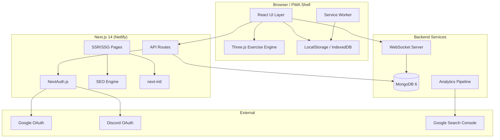
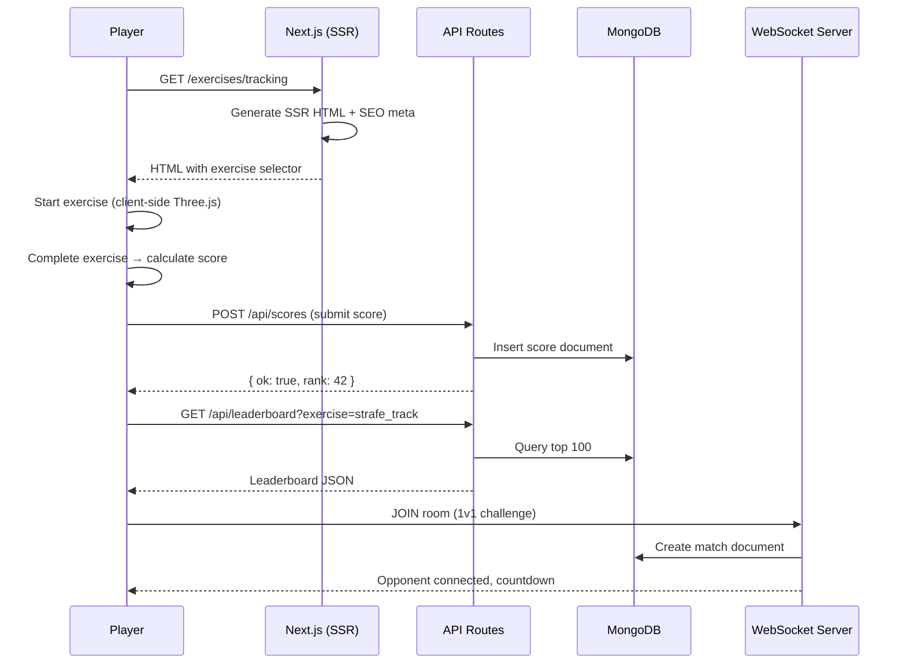
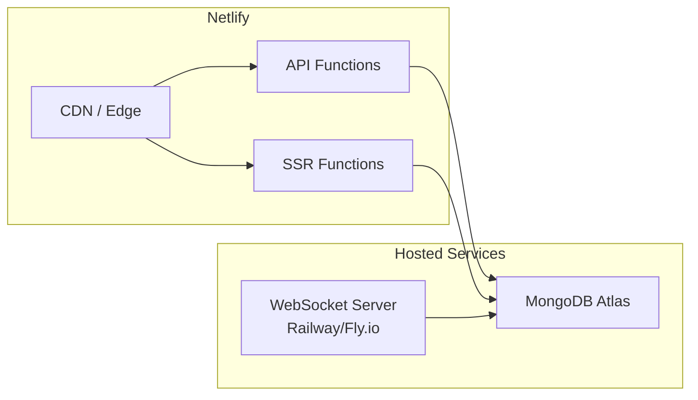
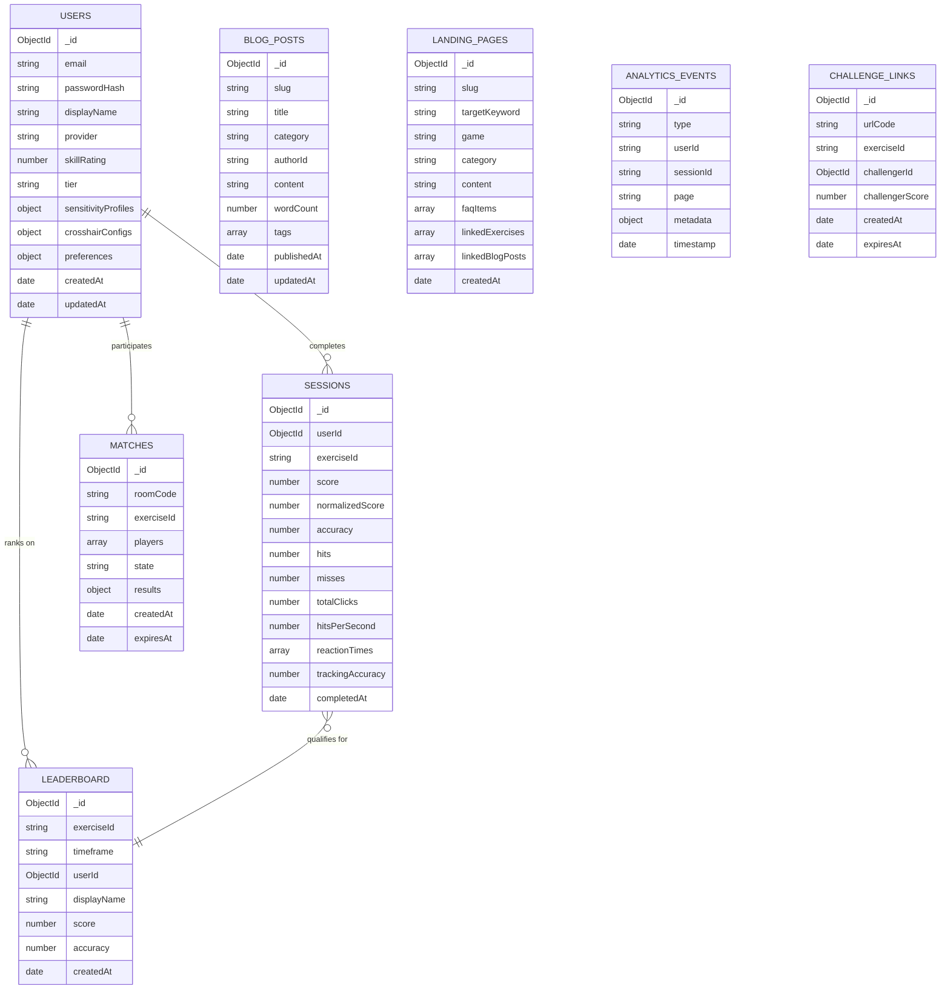

# Design Document: Full Aim Trainer SEO Platform

## Overview

This design transforms AimTrainerPro from its current architecture — a monolithic client-side game engine with static exercises and a basic MongoDB leaderboard — into a modular, SEO-first competitive aim training platform. The transformation preserves the existing Three.js rendering layer while introducing server-side rendering for SEO pages, a typed exercise framework, user authentication, real-time multiplayer, and comprehensive analytics.

### Current State

- **Frontend**: Next.js 14 App Router with a single client-side page loading vanilla JS scripts (game.js, exercise-engine.js, exercise-definitions.js)
- **Backend**: Two API routes (leaderboard GET/POST) backed by MongoDB
- **SEO**: Basic metadata in layout.tsx, sitemap.ts, robots.ts, one structured data block
- **Content**: Blog system with server-side rendering from JSON, minimal internal linking
- **Exercises**: 5 exercises in a single "Core Training" category with a Three.js renderer

### Target State

- **30+ exercises** across 6+ categories with configurable mechanics
- **Full SSR/SSG** for all content and landing pages (SEO-first)
- **User accounts** with OAuth, progression, and cross-device sync
- **Real-time 1v1** via WebSocket connections
- **PWA** with offline exercise support
- **i18n** with 6 languages and hreflang
- **100/100 Lighthouse SEO** on all static pages

### Key Design Decisions

| Decision | Choice | Rationale |
|----------|--------|-----------|
| Exercise engine location | Keep client-side JS, wrap with React hooks | Avoids rewriting the proven Three.js engine; React handles UI chrome |
| Authentication | NextAuth.js with MongoDB adapter | First-party Next.js solution; supports Google + Discord OAuth out of box |
| Real-time multiplayer | Socket.io on a separate Node process | WebSocket support not available in Netlify Functions; needs persistent connections |
| i18n approach | next-intl with JSON message bundles | File-based, SSG-compatible, supports App Router |
| Content/Landing pages | MDX with static generation at build time | SEO requires full SSR/SSG HTML; MDX allows embedded exercise widgets |
| Offline/PWA | next-pwa (Workbox under the hood) | Established solution for Next.js service worker generation |
| Sensitivity conversion | Pure TypeScript functions with game configs | Deterministic math with no external dependencies; easily testable |

---

## Architecture

### High-Level System Diagram



### Request Flow



### Deployment Architecture



---

## Components and Interfaces

### 1. Exercise System

#### Exercise Registry (TypeScript Module)

```typescript
// src/lib/exercises/types.ts
export interface ExerciseMechanics {
  targetSpawns: number;
  targetSize: number;
  targetStatic: boolean;
  gridBased?: boolean;
  reflexMode?: boolean;
  reflexTime?: number;
  pathSpeed?: number;
  pathPattern?: 'linear' | 'sinusoidal' | 'random' | 'acceleration';
  minDistance?: number;
  maxDistance?: number;
  respawnDelay: number;
  trackingMode?: boolean;
  trackingSampleRate?: number; // Hz, minimum 30
  headshotMode?: boolean;
  criticalZoneRatio?: number; // 0.0-1.0, default 0.3
  multiTarget?: boolean;
  sequentialElimination?: boolean;
}

export interface ScoringRules {
  hitReward: number;
  misspenalty: number;
  criticalMultiplier?: number; // default 2.0
  accuracyWeight?: number;    // 0.0-1.0, default 0.5
  speedWeight?: number;       // 0.0-1.0, default 0.3
  consistencyWeight?: number; // 0.0-1.0, default 0.2
}

export type DifficultyRating = 1 | 2 | 3 | 4 | 5;

export type ExerciseCategory =
  | 'flicking'
  | 'tracking'
  | 'speed'
  | 'precision'
  | 'reaction'
  | 'game-specific';

export interface ExerciseDefinition {
  id: string;
  name: string;
  description: string;
  category: ExerciseCategory;
  difficulty: DifficultyRating;
  duration: number; // seconds
  mechanics: ExerciseMechanics;
  scoringRules: ScoringRules;
  stats: string[];
  focusGames?: string[]; // e.g. ['valorant', 'cs2']
}

export interface ExerciseResult {
  exerciseId: string;
  score: number;         // 0-1000 normalized
  rawScore: number;      // actual points from hitReward
  accuracy: number;      // 0.0-1.0
  hits: number;
  misses: number;
  totalClicks: number;
  hitsPerSecond: number;
  reactionTimes: number[]; // ms per hit
  trackingAccuracy?: number; // 0.0-1.0 for tracking exercises
  timeToKills?: number[];   // ms per target for flicking
  completedAt: string;      // ISO timestamp
  duration: number;         // actual duration in seconds
}
```

#### Score Engine (Pure Functions)

```typescript
// src/lib/scoring/score-engine.ts
export interface NormalizedScoreInput {
  accuracy: number;      // hits / totalClicks
  hitsPerSecond: number;
  reactionTimes: number[];
  weights?: { accuracy: number; speed: number; consistency: number };
}

export function calculateNormalizedScore(input: NormalizedScoreInput): number {
  // Returns 0-1000
}

export function calculateTrackingAccuracy(
  samples: boolean[], // true = cursor in hitbox
  sampleRateHz: number
): number {
  // Returns 0.0-1.0
}

export function calculateStandardDeviation(values: number[]): number {
  // Returns std dev of reaction times
}

export function calculateSkillRating(
  sessions: ExerciseResult[],
  maxSessions: number // 20
): number {
  // Recency-weighted average, returns 0-5000
}

export function getPlayerTier(rating: number): PlayerTier {
  // Maps rating to Iron/Bronze/.../Radiant
}
```

### 2. Authentication System

```typescript
// src/lib/auth/types.ts
export interface UserProfile {
  id: string;
  email: string;
  displayName: string; // 3-16 alphanumeric + underscore
  provider: 'email' | 'google' | 'discord';
  skillRating: number;
  tier: PlayerTier;
  createdAt: string;
  sensitivityProfiles: SensitivityProfile[];
  crosshairConfigs: CrosshairConfig[];
}

export interface SensitivityProfile {
  id: string;
  game: string;
  sensitivity: number;
  dpi: number;
  trainerSensitivity: number; // calculated
}
```

#### Auth API Routes

```typescript
// src/app/api/auth/[...nextauth]/route.ts
// NextAuth.js configuration with:
// - CredentialsProvider (email/password, bcrypt hashed)
// - GoogleProvider
// - DiscordProvider
// - MongoDBAdapter for session/user storage
```

### 3. SEO Engine

```typescript
// src/lib/seo/types.ts
export interface PageSEO {
  title: string;        // 30-60 chars
  description: string;  // 120-160 chars
  canonical: string;    // absolute URL
  keywords: string[];
  structuredData: StructuredDataBlock[];
  hreflang?: HreflangEntry[];
  breadcrumbs?: BreadcrumbItem[];
}

export interface StructuredDataBlock {
  type: 'WebApplication' | 'Article' | 'BreadcrumbList' | 'FAQPage' | 'HowTo' | 'Person';
  data: Record<string, unknown>;
}

// src/lib/seo/metadata-generator.ts
export function generatePageMetadata(page: PageConfig): PageSEO {
  // Generates title (30-60 chars with keyword), description (120-160 chars)
  // Falls back to heading text / first 160 chars of body
}

export function generateBreadcrumbs(path: string): BreadcrumbItem[] {
  // Generates hierarchical breadcrumb from URL path
}

export function generateStructuredData(page: PageConfig): StructuredDataBlock[] {
  // Returns appropriate schema.org blocks based on page type
}
```

#### Sitemap Generation

```typescript
// src/app/sitemap.ts (enhanced)
export default async function sitemap(): Promise<MetadataRoute.Sitemap> {
  // Includes: exercises, categories, blog posts, landing pages, tools
  // Regenerated at build time (static generation)
}
```

### 4. Content System

```typescript
// src/lib/content/types.ts
export interface LandingPage {
  slug: string;
  title: string;
  targetKeyword: string;
  game?: string;
  category?: ExerciseCategory;
  content: string;       // MDX, >1500 words
  faqItems: FAQItem[];   // minimum 4
  linkedExercises: string[]; // minimum 3 exercise IDs
  linkedBlogPosts: string[]; // minimum 2 blog post slugs
  embeddedExercise: string;  // exercise ID for interactive embed
}

export interface BlogPostSchema {
  slug: string;
  title: string;          // H1
  content: string;        // MDX with H2/H3 hierarchy
  wordCount: number;      // minimum 1500
  category: 'training-guides' | 'game-specific-tips' | 'settings-optimization' | 'pro-player-analysis';
  author: AuthorProfile;
  publishedAt: string;
  internalLinks: InternalLink[]; // 2-5 contextual links
  embeddedExercises?: string[];
  tableOfContents?: TOCEntry[]; // auto-generated if >2000 words
}
```

### 5. Multiplayer System

```typescript
// src/lib/multiplayer/types.ts
export interface MatchRoom {
  code: string;          // 6 alphanumeric chars
  exerciseId: string;
  createdAt: string;
  expiresAt: string;     // createdAt + 5 minutes
  players: [MatchPlayer?, MatchPlayer?];
  state: 'waiting' | 'countdown' | 'active' | 'paused' | 'completed';
  disconnectTimer?: number; // 30 second countdown
}

export interface MatchPlayer {
  userId: string;
  displayName: string;
  isBot: boolean;
  score: number;
  accuracy: number;
  avgTimeToKill: number;
  connected: boolean;
}

// WebSocket events
export type WSClientEvent =
  | { type: 'join'; roomCode: string; userId: string }
  | { type: 'score_update'; score: number; accuracy: number }
  | { type: 'exercise_complete'; result: ExerciseResult }
  | { type: 'disconnect' };

export type WSServerEvent =
  | { type: 'room_joined'; room: MatchRoom }
  | { type: 'opponent_joined'; opponent: MatchPlayer }
  | { type: 'countdown'; seconds: number }
  | { type: 'match_start'; exerciseId: string }
  | { type: 'opponent_score'; score: number; accuracy: number }
  | { type: 'opponent_disconnected'; reconnectTimer: number }
  | { type: 'match_complete'; results: MatchResults }
  | { type: 'room_expired' }
  | { type: 'bot_offered' };
```

### 6. Sensitivity Converter

```typescript
// src/lib/tools/sensitivity-converter.ts
export interface GameConfig {
  id: string;
  name: string;
  yawPerCount: number; // degrees per mouse count at sens=1
  pitchPerCount?: number;
  formula: 'linear' | 'source' | 'quake' | 'custom';
  customFn?: (sens: number, dpi: number) => number;
}

export const SUPPORTED_GAMES: GameConfig[] = [
  { id: 'valorant', name: 'Valorant', yawPerCount: 0.07, formula: 'linear' },
  { id: 'cs2', name: 'CS2', yawPerCount: 0.022, formula: 'source' },
  { id: 'overwatch2', name: 'Overwatch 2', yawPerCount: 0.0066, formula: 'linear' },
  { id: 'apex', name: 'Apex Legends', yawPerCount: 0.022, formula: 'source' },
  { id: 'fortnite', name: 'Fortnite', yawPerCount: 0.5585, formula: 'linear' },
  // ... 10+ more games
];

export function convertSensitivity(
  fromGame: string,
  toGame: string,
  sensitivity: number,
  dpi: number
): number {
  // Pure function: converts between any two supported games
  // Accuracy within 0.1% of mathematically correct value
}

export function calculateTrainerSensitivity(
  game: string,
  sensitivity: number,
  dpi: number
): number {
  // Converts game sensitivity to trainer's internal scale
}

export function validateSensitivityInput(
  sensitivity: number,
  dpi: number
): { valid: boolean; error?: string } {
  // sensitivity: 0.01-100, dpi: 100-16000
}
```

### 7. Progression System

```typescript
// src/lib/progression/types.ts
export type PlayerTier =
  | 'Iron' | 'Bronze' | 'Silver' | 'Gold'
  | 'Platinum' | 'Diamond' | 'Immortal' | 'Radiant';

export const TIER_THRESHOLDS: Record<PlayerTier, [number, number]> = {
  Iron: [0, 624],
  Bronze: [625, 1249],
  Silver: [1250, 1874],
  Gold: [1875, 2499],
  Platinum: [2500, 3124],
  Diamond: [3125, 3749],
  Immortal: [3750, 4374],
  Radiant: [4375, 5000],
};

// src/lib/progression/skill-rating.ts
export function calculateWeightedAverage(
  sessions: ExerciseResult[],
  maxSessions: number
): number {
  // Most recent session gets highest weight
  // Uses exponential decay: weight_i = decay^(n - i - 1)
  // where n = number of sessions, i = index (0 = oldest)
}

export function compositeSkillRating(
  exerciseRatings: Map<string, number>
): number {
  // Weighted composite across all exercises
  // Returns 0-5000
}
```

### 8. PWA / Service Worker

```typescript
// Service Worker Strategy (Workbox via next-pwa)
// Cache strategies:
// - StaleWhileRevalidate: exercise definitions, blog content
// - CacheFirst (30 days): static assets (JS, CSS, images, audio)
// - NetworkFirst: API responses (leaderboard, user profile)
// - Offline queue: score submissions (max 50, chronological replay)

// src/lib/pwa/offline-queue.ts
export interface QueuedScore {
  exerciseId: string;
  result: ExerciseResult;
  queuedAt: string;
  retryCount: number; // max 3
}

export function queueOfflineScore(result: ExerciseResult): boolean {
  // Returns false if queue is full (50 items)
}

export async function flushOfflineQueue(): Promise<void> {
  // Submits in chronological order within 30 seconds
  // Retries failed submissions up to 3 times
}
```

### 9. Analytics Tracker

```typescript
// src/lib/analytics/types.ts
export interface AnalyticsEvent {
  type: 'page_view' | 'exercise_start' | 'exercise_complete' | 'score_submit' | 'signup' | 'share';
  userId?: string;
  sessionId: string;
  timestamp: string;
  metadata: Record<string, string | number>;
}

export interface DashboardMetrics {
  mau: number;
  dau: number;
  bounceRate: number;
  avgSessionDuration: number;
  exerciseCompletionRate: number;
  retentionRates: { day1: number; day7: number; day30: number };
  topPages: { path: string; visitors: number }[];
  trafficSources: { source: string; percentage: number }[];
}
```

### 10. Internationalization (i18n)

```typescript
// File structure: src/messages/{locale}.json
// Supported: en, es, pt, de, ja, zh

// src/middleware.ts (next-intl routing)
export default createMiddleware({
  locales: ['en', 'es', 'pt', 'de', 'ja', 'zh'],
  defaultLocale: 'en',
  localePrefix: 'as-needed' // /es/exercises but /exercises for English
});

// src/lib/i18n/types.ts
export type SupportedLocale = 'en' | 'es' | 'pt' | 'de' | 'ja' | 'zh';

export function getTranslation(key: string, locale: SupportedLocale): string {
  // Returns translated string or English fallback
}
```

---

## Data Models

### MongoDB Collections



### MongoDB Indexes

```javascript
// users
db.users.createIndex({ email: 1 }, { unique: true });
db.users.createIndex({ displayName: 1 }, { unique: true });
db.users.createIndex({ provider: 1, email: 1 });

// sessions
db.sessions.createIndex({ userId: 1, exerciseId: 1, completedAt: -1 });
db.sessions.createIndex({ exerciseId: 1, completedAt: -1 });

// leaderboard
db.leaderboard.createIndex({ exerciseId: 1, timeframe: 1, score: -1 });
db.leaderboard.createIndex({ userId: 1, exerciseId: 1, timeframe: 1 });

// matches
db.matches.createIndex({ roomCode: 1 }, { unique: true });
db.matches.createIndex({ expiresAt: 1 }, { expireAfterSeconds: 0 });

// analytics_events
db.analytics_events.createIndex({ type: 1, timestamp: -1 });
db.analytics_events.createIndex({ sessionId: 1, timestamp: 1 });

// challenge_links
db.challenge_links.createIndex({ urlCode: 1 }, { unique: true });
db.challenge_links.createIndex({ expiresAt: 1 }, { expireAfterSeconds: 0 });
```

### Key Data Schemas (Mongoose/Validation)

```typescript
// Score validation constraints
const MAX_SCORE_PER_EXERCISE: Record<string, number> = {
  // hitReward × maximum_possible_hits_in_duration
  static_grid: 100 * 400,   // 100 reward × ~400 hits possible in 60s
  micro_adjust: 150 * 300,
  pop_up_reflex: 200 * 86,  // 200 reward × 60s/0.7s respawn
  strafe_track: 50 * 200,
  dynamic_flicks: 120 * 240,
};

// Display name validation
const DISPLAY_NAME_REGEX = /^[a-zA-Z0-9_]{3,16}$/;

// Sensitivity validation
const SENSITIVITY_RANGE = { min: 0.01, max: 100 };
const DPI_RANGE = { min: 100, max: 16000 };
```

---
