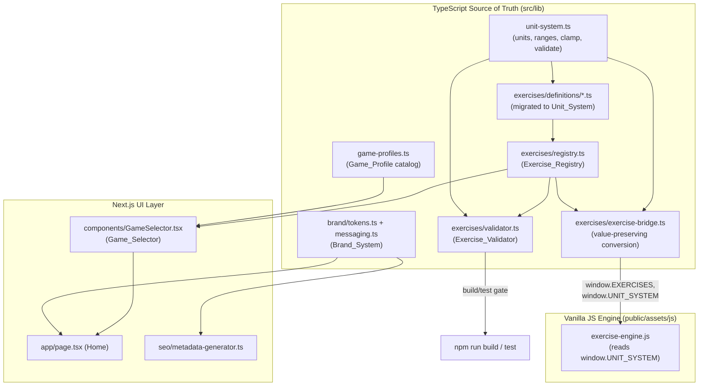

# Design Document

## Overview

This design repositions AimTrainerPro from a Valorant-themed trainer into a neutral, multi-game aim trainer, and repairs the broken exercise engine so that every exercise for every game spawns reachable, correctly sized targets and produces correct scores.

The work divides into five cohesive design areas that map directly to the requirements:

1. **Brand System** (Req 1) — a game-agnostic visual identity (tokens, messaging, PWA identity) that replaces Valorant-specific branding everywhere.
2. **Unit System** (Req 2) — a single documented source of truth for measurement units and value ranges, shared by the TypeScript registry and the vanilla JS engine, with a bridge that preserves values losslessly and an engine that clamps out-of-range values instead of silently substituting defaults.
3. **Reachable Spawning & Playability** (Req 3, Req 4) — engine spawn geometry and scoring logic corrected so targets always render fully inside the reachable play area and scoring is well-defined.
4. **Multi-Game Navigation** (Req 5) — a Game Selector that filters the existing exercise catalog by game profile and category.
5. **Validation Guardrails** (Req 7) — a build/test-time validator that fails the build when any definition violates the unit system or would spawn off-screen.

A sixth area, **Preservation** (Req 6), is a cross-cutting constraint: the redesign must not regress leaderboard, progression, multiplayer, blog, SEO, i18n, deep links, or PWA/offline support.

### Root-Cause Summary

The engine and definitions disagree about units in two specific places:

- **Spawn distance.** Definitions write `minDistance: 200, maxDistance: 600`. In `exercise-engine.js`, the radial spawn path uses these values directly as a world-unit radius (`rad = minR + Math.random() * (maxR - minR)`), but the reachable play area only spans roughly `x ∈ [-35, 35]`, `y ∈ [-12, 12]` at `z = -45`. Any distance above ~35 spawns the target outside the area the player can aim at.
- **Target size.** Definitions write `targetSize: 20–40`. In `createTargetMesh`, the engine does `if (isNaN(size) || size <= 0 || size > 10) size = 2.0;` — so any size above 10 is silently discarded and replaced with the default 2.0, making per-exercise sizing meaningless.

The fix is not to special-case individual exercises but to establish one validated unit system, migrate all definitions onto it, make the engine honor it (clamping rather than discarding), and add a validator so the defect cannot return.

## Architecture



Design principles preserved from the existing codebase:

- **TypeScript is the source of truth.** Definitions, registry, unit system, game profiles, and validator all live in `src/lib`. The vanilla JS engine remains the renderer and receives data exclusively through the bridge on `window`.
- **The bridge is the only boundary** between the typed world and the engine. It already installs `window.EXERCISES` and `window.getExerciseById`; we extend it to also install `window.UNIT_SYSTEM` so the engine has one authoritative set of constants instead of hardcoded magic numbers.
- **Additive UI.** The Game Selector is a new React component layered onto the existing home page and category UI; it does not replace the working exercise/leaderboard/settings tabs.

## Components and Interfaces

### 1. Unit System (`src/lib/exercises/unit-system.ts`) — NEW

The documented single source of truth for units and ranges, consumed by definitions, validator, bridge, and (via `window`) the engine.

```typescript
/** All distances/sizes are world units; speed is world units per second. */
export interface UnitRange { min: number; max: number; }

export const UNIT_SYSTEM = {
  // Documented units
  units: {
    spawnDistance: 'world-units',
    targetSize: 'world-units',
    pathSpeed: 'world-units-per-second',
  },
  // Valid inclusive ranges (Req 2.2)
  ranges: {
    spawnDistance: { min: 0,    max: 35 } as UnitRange,
    targetSize:    { min: 0.25, max: 10 } as UnitRange,
    pathSpeed:     { min: 0,    max: 50 } as UnitRange,
  },
  // Reachable play area derived bounds the engine must respect (Req 3)
  playArea: {
    halfWidth: 35,   // |x| <= 35
    halfHeight: 12,  // |y| <= 12
    depth: -45,      // target plane z
    minHittableRadius: 0.25,
  },
} as const;

export type MechanicsField = 'spawnDistance' | 'targetSize' | 'pathSpeed';

/** Clamp a value to the nearest valid bound for a field (Req 2.7). */
export function clampToRange(field: MechanicsField, value: number): number;

/** True iff value is within the inclusive range for the field (Req 7.1). */
export function isWithinRange(field: MechanicsField, value: number): boolean;

/** Max spawn distance whose target of `targetSize` still fits in play area (Req 3.1, 3.6). */
export function maxReachableDistance(targetSize: number): number;
```

`maxReachableDistance` encodes the geometric constraint: a target of radius `r` spawned at radial distance `d` (with the engine's vertical compression factor) must satisfy that its full extent stays inside `playArea`. The engine and validator both call this so they agree by construction.

A plain-data mirror of `UNIT_SYSTEM` is what the bridge serializes onto `window.UNIT_SYSTEM`; the functions are re-implemented as small pure helpers inside the engine that read those same constants, so there is exactly one set of numbers.

### 2. Exercise Bridge (`src/lib/exercises/exercise-bridge.ts`) — MODIFIED

- `toVanillaExercise` continues to copy mechanics, but the design adds an explicit **value-preservation contract**: every numeric mechanics value the engine receives must equal the definition value within 0.01 world units (Req 2.5). Since the current implementation copies by direct assignment, the contract holds; we lock it in with a property test rather than changing logic.
- `installBridge` additionally sets `window.UNIT_SYSTEM` to the plain-data mirror so the engine stops using hardcoded `RANGE_X = 35`, size-reset `> 10`, and radial `maxR` magic numbers.

### 3. Exercise Engine (`public/assets/js/exercises/exercise-engine.js`) — MODIFIED

Three focused changes, all reading from `window.UNIT_SYSTEM` with fallbacks equal to the documented constants:

- **`createTargetMesh` size handling.** Replace `if (... size > 10) size = 2.0;` with `size = clampToRange('targetSize', size)`. Sizes in `[0.25, 10]` are rendered exactly (after the existing device multiplier, whose clamp floor/ceiling is widened to honor the configured size); only out-of-range sizes are clamped to the nearest bound (Req 2.6, 2.7).
- **`spawnTargets` radial/grid placement.** Interpret `minDistance/maxDistance` as world-unit spawn distances in `[0, 35]`, clamp them with `clampToRange('spawnDistance', …)`, and cap the effective radius at `maxReachableDistance(targetSize)` so the full target extent (including radius) stays inside the play area for single and concurrent spawns (Req 3.1, 3.2, 3.6). Grid placement is bounded the same way.
- **Path/movement clamping.** In `update`, the existing bounce keeps `|x| <= 35`, `|y| <= 12`; extend it to account for target radius so the *rendered extent* (not just the center) stays inside the area at every frame (Req 3.3), and clamp `pathSpeed` to `[0, 50]`.

Scoring logic in `handleInput`, `checkAimOverTarget`, the tracking sampler, and `getExerciseResult` is already close to correct; the design tightens the invariants:

- Miss penalty already floors score at 0 via `Math.max(0, …)` (Req 4.3).
- `getExerciseResult` computes `accuracy = hits / totalClicks`; we change the zero-activity case so accuracy is `0` when there are no hits and no misses (Req 4.5) rather than `hits/1`.
- Headshot, sequential-elimination, and tracking-accuracy branches are preserved and pinned by properties (Req 4.6, 4.7, 4.8).

### 4. Game Profiles (`src/lib/exercises/game-profiles.ts`) — NEW

```typescript
export interface GameProfile {
  id: string;        // 'valorant' | 'cs2' | 'apex' | 'fortnite' | 'overwatch2' | ...
  name: string;      // display name, used ONLY in listings/filters (Req 1.4)
  slug: string;
}

export const GAME_PROFILES: GameProfile[];

/** Game profiles that have at least one associated exercise (Req 5.1). */
export function getActiveGameProfiles(registry: ExerciseDefinition[]): GameProfile[];

/** Exercises for a game profile, optionally scoped to a category (Req 5.2, 5.3). */
export function getExercisesForGame(
  registry: ExerciseDefinition[],
  gameId: string | null,
  category?: ExerciseCategory | null
): ExerciseDefinition[];
```

Association uses the existing `focusGames?: string[]` field on `ExerciseDefinition`. Exercises with no `focusGames` are treated as game-agnostic and appear under "All games" only.

### 5. Game Selector (`src/components/GameSelector.tsx`) — NEW

A client component rendered inside the existing exercises tab on `app/page.tsx`. Responsibilities:

- List active game profiles plus an "All exercises" control (Req 5.1).
- On game/category selection, filter the in-memory registry and re-render (no network round-trip), satisfying the 1-second budget (Req 5.2, 5.3).
- Default to all exercises when nothing is selected (Req 5.4).
- Show an empty-state message for game+category combinations with no exercises (Req 5.7).
- Hand off the chosen exercise id to the existing `window.ExerciseController` flow; surface an error and a return-to-selector control if the engine fails to load (Req 5.8).

Because filtering is pure (registry + filters → exercise list), it is unit/property testable independent of the DOM.

### 6. Brand System (`src/lib/brand/`) — NEW + edits across pages

- `tokens.ts`: one color palette and one typography set exported as the canonical theme; `globals.css` / Tailwind config consume these tokens so all pages share them (Req 1.5).
- `messaging.ts`: hero heading, hero subheading, meta title, and meta description strings that name ≥2 game profiles and no single profile more prominently than another (Req 1.2). These are validated by a test that counts per-profile mentions.
- Replacement pass: remove the Riot/Valorant disclaimer and "AIMTRAINER PRO / Valorant" framing from `app/page.tsx`, update `seo/metadata-generator.ts` and `app/layout.tsx` titles, and swap PWA identity in `public/manifest.json`, icons, and favicon (Req 1.1, 1.3, 1.4, 1.6). Game names remain allowed only inside exercise listings/filters/descriptions.

### 7. Exercise Validator (`src/lib/exercises/validator.ts`) — NEW

```typescript
export interface ValidationFailure {
  exerciseId: string;   // offending definition (Req 7.2, 7.3)
  field: MechanicsField;
  value: number;
  reason: 'out-of-range' | 'unreachable';
}

export interface ValidationReport {
  ok: boolean;
  failures: ValidationFailure[];   // every violation, not just the first (Req 7.4)
}

/** Validate every definition against the Unit_System and reachability. */
export function validateRegistry(registry: ExerciseDefinition[]): ValidationReport;
```

- Checks each of `spawnDistance` (from `minDistance/maxDistance`), `targetSize`, `pathSpeed` against `UNIT_SYSTEM.ranges` (Req 7.1).
- Flags a definition whose `maxDistance` exceeds `maxReachableDistance(targetSize)` as `unreachable` (Req 7.2).
- Aggregates all failures across all definitions and fields (Req 7.4); returns `ok: true` with zero failures when clean (Req 7.5).
- Wired into the test suite via a `validator.test.ts` that fails when `report.ok === false`, and invoked at build time through a `prebuild`/build step so a violation terminates the build/test run unsuccessfully (Req 7.6, 7.7).

## Data Models

### ExerciseDefinition (existing, semantics clarified)

The interface in `src/lib/exercises/types.ts` is unchanged structurally. The redesign re-specifies the **meaning and valid range** of its numeric mechanics fields per the unit system:

| Field | Unit | Inclusive Range | Notes |
|-------|------|-----------------|-------|
| `minDistance` / `maxDistance` | world units | 0 – 35 | Spawn distance; was 20–600 |
| `targetSize` | world units | 0.25 – 10 | Was 20–40; engine no longer discards |
| `pathSpeed` | world units / s | 0 – 50 | Was up to 400 |
| `criticalZoneRatio` | ratio | 0 – 1 | Unchanged |
| `respawnDelay` | seconds | ≥ 0 | Unchanged |

All ~30 definitions across the six category files are migrated to these ranges. Migration preserves relative difficulty (e.g. an AWP flick stays at the far end of the spawn-distance range, near 35) rather than mechanically rescaling.

### EngineRawResult / ExerciseResult (existing)

Unchanged. The redesign tightens the `accuracy` field contract: `accuracy ∈ [0, 1]`, equal to `hits / (hits + misses)`, and exactly `0` when both are zero.

### GameProfile (new)

```typescript
{ id: string; name: string; slug: string; }
```

### Brand tokens (new)

```typescript
{ palette: Record<string,string>; typography: { fontFamily: string; ... } }
```

## Correctness Properties

*A property is a characteristic or behavior that should hold true across all valid executions of a system — essentially, a formal statement about what the system should do. Properties serve as the bridge between human-readable specifications and machine-verifiable correctness guarantees.*

The following properties are derived from the testable acceptance criteria (see prework). Each is universally quantified and maps to the requirements it validates. Properties that were logically redundant have been consolidated (e.g. the per-target reachability invariant covers single, concurrent, and out-of-range spawns; the result/accuracy property covers the zero-activity edge).

### Property 1: Clamping maps any value to the nearest valid bound

*For any* real number `v` and any mechanics field `f`, `clampToRange(f, v)` returns a value within `UNIT_SYSTEM.ranges[f]`, and returns the nearest bound (min or max) whenever `v` falls outside that range, and returns `v` unchanged when `v` is already inside it.

**Validates: Requirements 2.7**

### Property 2: Target size resolution honors configured size and minimum hittable size

*For any* configured `targetSize` in `[0.25, 10]`, the engine's resolved render radius is a monotonic function of the configured size that never collapses to the legacy `2.0` default, and *for any* configured `targetSize` (in or out of range), the resolved render radius is at least `UNIT_SYSTEM.playArea.minHittableRadius`.

**Validates: Requirements 2.6, 3.5**

### Property 3: The bridge preserves mechanics values

*For any* `ExerciseDefinition`, every numeric mechanics value in the `toVanillaExercise` output is numerically equal to the corresponding source value within 0.01 world units.

**Validates: Requirements 2.5**

### Property 4: Every definition's mechanics values lie within the unit system ranges

*For any* `ExerciseDefinition` in the `Exercise_Registry`, its `spawnDistance` (min and max), `targetSize`, and `pathSpeed` values each fall within the inclusive range defined by `UNIT_SYSTEM`.

**Validates: Requirements 2.3**

### Property 5: Spawned targets are fully inside the reachable play area

*For any* `ExerciseDefinition` (including those configuring multiple concurrent targets or distances outside the valid range) and *any* spawn randomization, every spawned target's center plus its full rendered radius lies within `|x| <= playArea.halfWidth` and `|y| <= playArea.halfHeight`.

**Validates: Requirements 3.1, 3.2, 3.6**

### Property 6: Moving targets stay inside the reachable play area for their whole lifetime

*For any* moving target configuration and *any* number of simulated update steps, the target's center plus its full rendered radius remains within the reachable play-area bounds at every step from spawn until removal.

**Validates: Requirements 3.3**

### Property 7: A hit increases the score by the hit reward

*For any* exercise state and *any* non-negative `hitReward`, registering a standard hit increases the score by exactly `hitReward` and increases the hit count by exactly one.

**Validates: Requirements 4.2**

### Property 8: A miss applies the penalty and never drives the score below zero

*For any* current score and *any* non-negative miss penalty, registering a miss sets the score to `max(0, score - penalty)` and increases the miss count by exactly one.

**Validates: Requirements 4.3**

### Property 9: Final results are internally consistent and accuracy is well-defined

*For any* sequence of registered hit and miss events, the final result has `score >= 0`, `hitCount` equal to the number of hit events, `missCount` equal to the number of miss events, and `accuracy` equal to `hitCount / (hitCount + missCount)` constrained to `[0, 1]`, with `accuracy = 0` when there are zero hits and zero misses.

**Validates: Requirements 4.4, 4.5**

### Property 10: Headshot scoring applies the critical multiplier only inside the critical zone

*For any* headshot-mode target with critical zone ratio `c` and *any* hit point, the awarded reward equals `hitReward * criticalMultiplier` when the hit lies within the critical radius and equals `hitReward` (no multiplier) when it lies outside the critical radius but inside the target.

**Validates: Requirements 4.6**

### Property 11: Sequential elimination counts only in-order eliminations as hits

*For any* set of ordered targets and *any* sequence of player interactions, an interaction is counted as a hit if and only if it targets the next expected order index; all other interactions are counted as misses.

**Validates: Requirements 4.7**

### Property 12: Tracking accuracy equals on-target sample ratio within [0,1]

*For any* boolean sample array and *any* positive sample rate, the tracking accuracy equals the number of on-target samples divided by the total number of samples, lies within `[0, 1]`, and equals `0` when the sample array is empty.

**Validates: Requirements 4.8**

### Property 13: Active game profiles are exactly those with at least one exercise

*For any* exercise registry, `getActiveGameProfiles` returns exactly the set of game profiles for which at least one exercise lists that profile in its `focusGames`.

**Validates: Requirements 5.1**

### Property 14: Game and category filtering returns exactly the matching exercises

*For any* registry, optional `gameId`, and optional `category`, `getExercisesForGame` returns exactly the exercises that match the active game scope (all exercises when `gameId` is null) and the active category scope (all categories when `category` is null).

**Validates: Requirements 5.2, 5.3, 5.4**

### Property 15: Missing translations fall back to English

*For any* supported locale and *any* message key that is absent in that locale, the resolved string equals the English value for that key.

**Validates: Requirements 6.4**

### Property 16: Offline-queued results survive a reconnect round trip

*For any* sequence of results enqueued while offline, the set of results flushed on reconnect equals the enqueued set with no loss and no duplication.

**Validates: Requirements 6.7**

### Property 17: Every registered exercise id resolves to its exercise via deep link

*For any* exercise id present in the registry, the deep-link resolver returns the exercise with that id.

**Validates: Requirements 6.8**

### Property 18: The validator detects out-of-range values and reports the offending id and field

*For any* registry, the set of out-of-range failures reported by `validateRegistry` equals the set of `(exerciseId, field)` pairs whose value lies outside its unit-system range, each failure naming the offending exercise id and field; a registry with no out-of-range and no unreachable values yields `ok = true` with no failures.

**Validates: Requirements 7.1, 7.3, 7.5**

### Property 19: The validator flags unreachable spawn distances

*For any* `ExerciseDefinition`, `validateRegistry` reports an `unreachable` failure (naming the id and field) if and only if the definition's `maxDistance` exceeds `maxReachableDistance(targetSize)`.

**Validates: Requirements 7.2**

### Property 20: The validator reports every violation, not just the first

*For any* registry, the number of failures reported by `validateRegistry` equals the total number of violating `(exerciseId, field)` pairs across all definitions.

**Validates: Requirements 7.4**

## Error Handling

- **Out-of-range mechanics values (runtime).** The engine clamps rather than throws (Property 1), so a malformed definition degrades gracefully to a playable target instead of crashing or spawning off-screen. The validator (below) prevents such definitions from shipping in the first place.
- **Exercise load failure (Req 5.8).** The Game Selector wraps `ExerciseController` startup; if script load or `initExercise` fails, it renders an inline error with a "Back to games" action rather than leaving a blank canvas.
- **Empty filter result (Req 5.7).** Game+category combinations with no exercises render a dedicated empty-state message; this is a normal state, not an error.
- **Storage/leaderboard unavailable (Req 6.1, 6.7).** Progression and leaderboard writes are wrapped in try/catch (as today) and treated as non-critical; when offline, results are enqueued via the offline queue and flushed on reconnect (Property 16). Score display never blocks on these.
- **Deep-link not found (Req 6.9).** An unknown exercise id resolves to a not-found view offering navigation to the exercise list, rather than a hard 404 with no recovery path.
- **Missing translation (Req 6.4).** The i18n resolver falls back to English (Property 15) instead of rendering a raw key or empty string.
- **Validator failure (Req 7.7).** A non-empty `ValidationReport.failures` causes `validator.test.ts` to fail and the build step to exit non-zero, blocking release.

## Testing Strategy

This feature is a strong fit for property-based testing: the unit system, bridge, spawn geometry, scoring, filtering, i18n fallback, offline queue, and validator are all pure functions (or can be refactored into pure helpers) with meaningful input variation. UI, branding, PWA, and infrastructure concerns use example, snapshot, and smoke tests instead.

### Property-Based Tests

- **Library.** Use [`fast-check`](https://github.com/dubzzz/fast-check) with the existing Vitest runner (add `fast-check` as a dev dependency). Do not hand-roll generators or shrinking.
- **Iterations.** Each property test runs a minimum of 100 generated cases (`fc.assert(..., { numRuns: 100 })` or higher).
- **Tagging.** Each property test is tagged with a comment in the format: `// Feature: multi-game-redesign, Property {number}: {property text}` and references the design property it implements.
- **One test per property.** Each of Properties 1–20 is implemented by a single property-based test.
- **Pure-helper extraction.** To test engine behavior (Properties 2, 5, 6, 7, 8, 9, 10, 11) without a DOM/WebGL context, extract the relevant math into pure helpers (`resolveTargetSize`, `computeSpawnPosition`, `stepMovement`, `applyHit`, `applyMiss`, `computeResult`, `headshotReward`, `sequentialOutcome`) shared between the engine and the tests, so the rendered engine and the tested logic are the same code.

### Unit / Example Tests

- Brand messaging balance and forbidden-token scans (Req 1.1, 1.2, 1.3, 1.4).
- Game Selector empty-state and load-failure rendering (Req 5.7, 5.8).
- Default-state (no game selected) rendering (Req 5.6).
- Deep-link not-found view (Req 6.9).
- Specific scoring examples that complement the properties (e.g. a concrete headshot critical hit).

### Smoke / Configuration Tests

- Unit system constants and documented units exist and equal the specified values (Req 2.1, 2.2).
- PWA manifest name/icons contain no forbidden single-game tokens (Req 1.6, 6.6).
- All six locale files present with key parity (Req 6.3).
- Validator is wired into the test suite and the build step (Req 7.6, 7.7).

### Integration / Regression Tests

- Engine interpretation consistency end to end (Req 2.4) and camera-rotation visibility at extreme reachable positions (Req 3.4).
- Exercise runs to its completion condition without early exit (Req 4.1) and loads within budget (Req 5.5).
- Completion persists to progression + leaderboard and is retrievable (Req 6.1).
- Existing leaderboard, blog, multiplayer, challenge, and SEO/structured-data suites continue to pass post-redesign (Req 6.2, 6.5), including the previously valid deep links (Req 6.8 examples).

### Migration Verification

After migrating all definitions to the new unit ranges, run `validateRegistry` over the real registry as part of the suite; it must report `ok = true`. This is the concrete acceptance gate that every shipped exercise is reachable and correctly sized (Req 2.3, 7.5).
